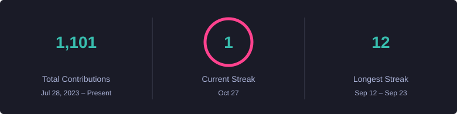
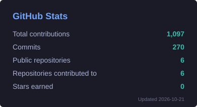
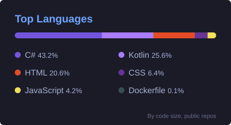

<div align="center">


<p>
  <a href="mailto:lucdemarillac@gmail.com"></a>
  <a href="https://github.com/LucdeMarillacStJulien?tab=repositories"></a>
  
</p>

</div>

---

## 🧩 What I build

I'm a Computer Engineering student at **The IIE** who'd rather ship a working full-stack system than another CRUD exercise — decoupled APIs with real auth, background services, encryption and CI.

```yaml
focus:      full-stack systems, end to end
backend:    ASP.NET Core Web API · EF Core · SignalR · ASP.NET Identity
frontend:   Blazor Server · Jetpack Compose · MVC · WPF
cloud:      Azure Functions · Azure Storage · Firebase · Docker Compose
patterns:   Factory · Observer · role-based workflows · JWT · AES at rest
currently:  wiring Gemini Vision into things that shouldn't have AI in them
```

<div align="center">
  
</div>

---

## 🚀 Featured projects

<table>
<tr>
<td width="50%" valign="top">

### 🚚 [GLMS — Logistics Management](https://github.com/LucdeMarillacStJulien/logistics-management-system)
Decoupled **ASP.NET Core Web API + Blazor Server** logistics platform. JWT auth, SignalR live tracking, Factory/Observer patterns, Dockerised SQL Server, live currency conversion.

`ASP.NET Core` `Blazor` `EF Core` `SignalR` `Docker`

</td>
<td width="50%" valign="top">

### 📑 [Contract Monthly Claim System](https://github.com/LucdeMarillacStJulien/contract-claim-system)
Four-stage approval workflow — Lecturer → Coordinator → Manager → HR — with **AES-encrypted** document uploads and CSV invoice generation.

`ASP.NET Core MVC` `EF Core` `Identity`

</td>
</tr>
<tr>
<td width="50%" valign="top">

### 🧾 [BudgtAI](https://github.com/LucdeMarillacStJulien/budgtai)
Android budgeting app that reads your receipts with **Gemini Vision**, syncs live through Firestore, and gamifies saving with XP, levels and badges.

`Kotlin` `Jetpack Compose` `Firebase` `Gemini`

</td>
<td width="50%" valign="top">

### 🛒 [Azure E-Commerce Platform](https://github.com/LucdeMarillacStJulien/azure-ecommerce-platform)
Storefront with products, cart, orders and inventory, backed by **Azure Functions** writing to blob, queue and table storage.

`ASP.NET Core` `Azure Functions` `Azure Storage`

</td>
</tr>
</table>

> 🛡️ **Cybersecurity Awareness Chatbot** — WPF desktop assistant that teaches security best practice through keyword/pattern parsing, a task & reminder system and a scored quiz. `C#` `WPF` `.NET Framework`

---

## 📊 By the numbers

<div align="center">







<picture>
  <source media="(prefers-color-scheme: dark)" srcset="https://raw.githubusercontent.com/LucdeMarillacStJulien/LucdeMarillacStJulien/output/snake-dark.svg" />
  
</picture>

<sub>Stat cards are generated from the GitHub GraphQL API by <a href="./scripts/generate_stats.py">a script in this repo</a> and committed daily — no third-party service rendering them.</sub>

</div>

---

<div align="center">
  
</div>
